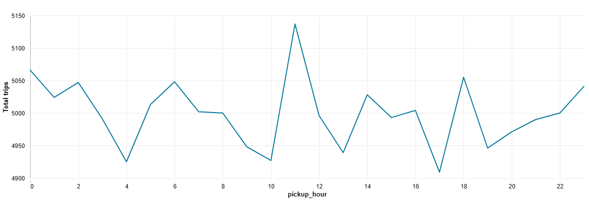
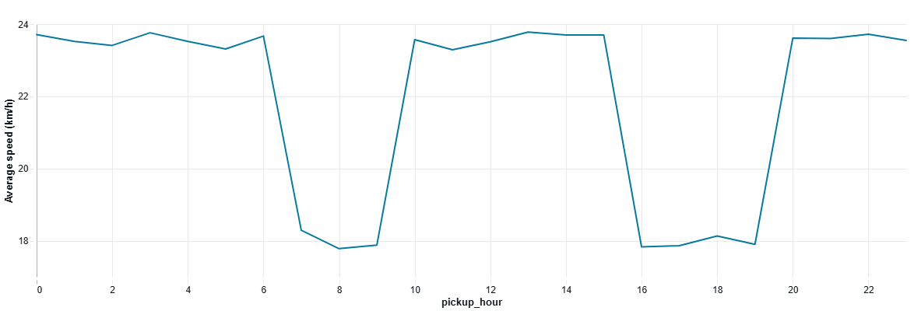
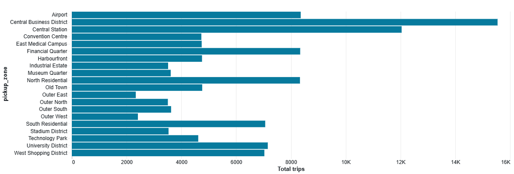
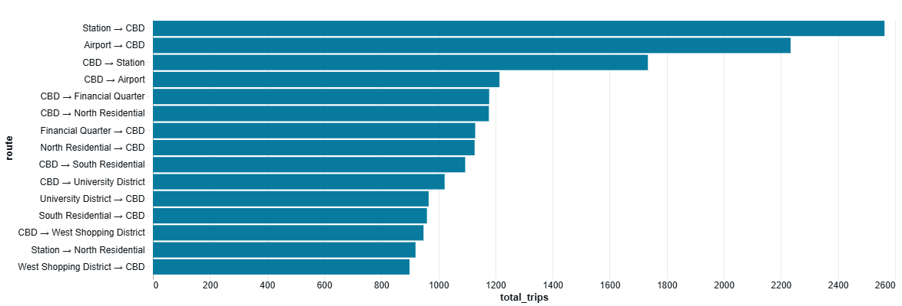
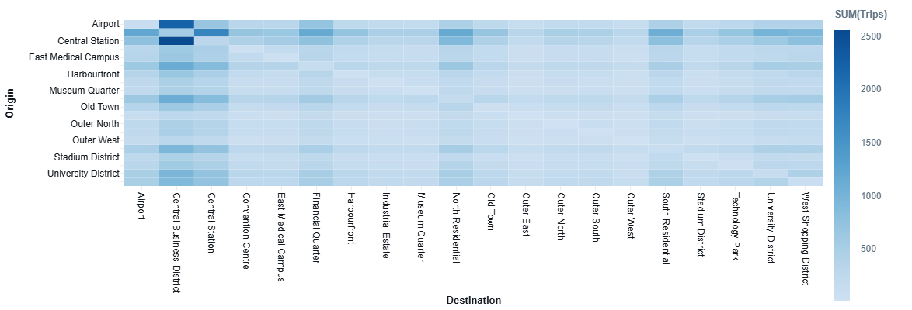
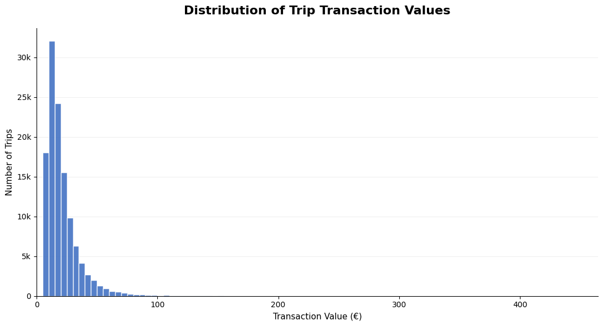
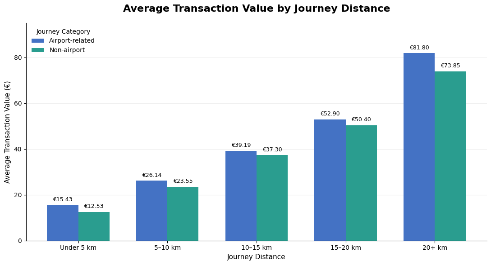
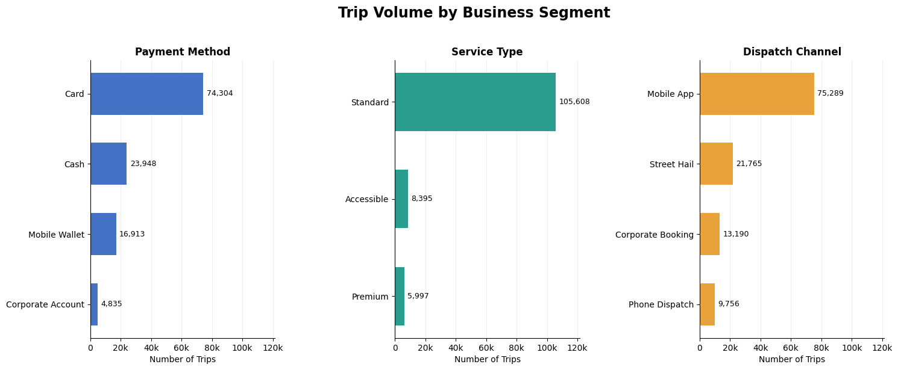
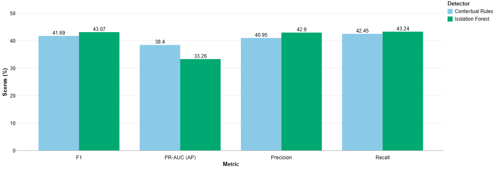
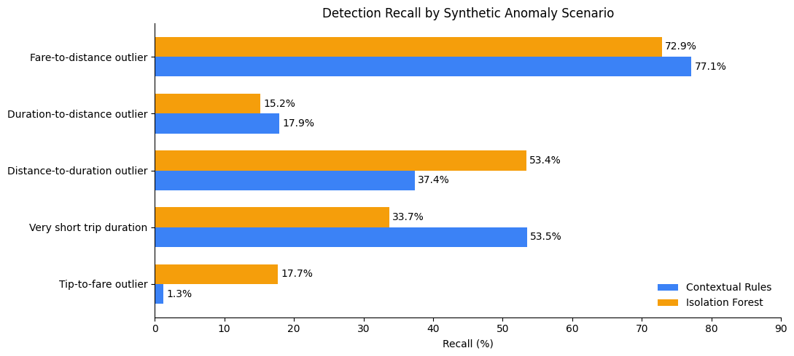

# Urban Mobility Intelligence
### Transportation Analytics and Anomaly Detection

## Tech Stack


## 1. Project Overview

Transportation companies generate large amounts of data from daily journeys, including trip distances, travel times, locations, fares, and payment information.

However, collecting this information is only useful when it can support better decisions.

For example:
- Which locations and routes experience the most travel activity?
- When do journeys take longer than expected?
- How do transaction values differ across journeys and services?
- Which trips have unusual characteristics that may require further investigation?
- How can companies identify potential issues without reviewing every transaction manually?

**Urban Mobility Intelligence** explores these questions using 120,000 simulated taxi journeys across a fictional metropolitan area.

The project combines transportation analytics with anomaly detection to demonstrate how trip and transaction data can support operational planning, transaction monitoring, and more informed decision-making.

## 2. Business Problem

Transportation operators must balance service efficiency, customer experience, and financial oversight.

Without a structured way to analyse journey data, companies may struggle to identify patterns across thousands of trips or distinguish unusual transactions from normal operational variation.

For instance, a journey with a high fare may be perfectly reasonable if it covers a long distance. Similarly, a slow journey during peak commuting hours may not indicate a problem.

Flagging such trips without considering their circumstances could lead to unnecessary investigations.

This project addresses two related challenges:

**Operational visibility:** Understanding where, when, and how journeys occur so that companies can investigate service patterns and potential inefficiencies.

**Unusual activity monitoring:** Identifying trips whose pricing or journey characteristics differ significantly from typical behaviour, helping teams prioritize records for further review.

## 3. Project Objectives

The project aims to:

1. Build a structured process for loading, validating, and analysing large volumes of journey records.
2. Examine travel patterns across time periods, locations, routes, and transaction categories.
3. Identify operational and financial patterns that could inform business decisions.
4. Develop contextual measures that account for normal differences in journey behaviour.
5. Compare two approaches for detecting unusual trips.
6. Evaluate the trade-off between identifying more unusual cases and generating additional review alerts.

## 4. Approach

The project follows four stages.

### Stage 1 — Data Preparation

Loaded and validated 120,000 simulated journey records using PySpark and Databricks.

Checks included missing values, duplicate records, trip timestamps, transaction calculations, and geographical references.

Validated data was stored in Delta Lake tables for subsequent analysis.

### Stage 2 — Transportation and Transaction Analysis

Explored travel activity across time periods, pickup locations, routes, service types, payment methods, and booking channels.

The analysis examined journey volumes, travel speeds, durations, and transaction values to understand how different operational conditions relate to trip behaviour.

### Stage 3 — Understanding Journey Context

Developed additional measures that compare each journey with typical behaviour during the same operational time period.

For example, instead of considering a journey's speed in isolation, the analysis compares it with the typical speed for peak or off-peak periods.

This provides a more meaningful way to investigate unusual journeys.

### Stage 4 — Detecting Unusual Activity

Compared two approaches:

**Contextual Rules**

A straightforward method that flags journeys with unusually large differences in speed, duration, or fare per kilometre.

**Isolation Forest**

A machine learning method that examines multiple journey characteristics together to identify records that stand out from typical patterns.

The models were developed without using the dataset's preassigned unusual-trip labels. Those labels were used only to evaluate the results.

## 5. Key Findings and Business Implications


### A. Travel Activity and Journey Efficiency

**Business question:** How does travel activity change throughout
the day, and what could this mean for transportation operations?

#### Key Findings

Analysis of 120,000 simulated journeys revealed that:

- Hourly trip volumes remained relatively stable, with each
  hour accounting for approximately 4.09%–4.28% of journeys.
- Morning peak journeys took approximately 31.6% longer
  than off-peak journeys.
- Evening peak journeys took approximately 29.8% longer
  than off-peak journeys.
- Average travel speeds were approximately 24% lower
  during peak periods, despite similar trip distances.

#### Travel Activity by Hour



*Figure 1: Number of journeys recorded across different hours.*

#### Journey Speed by Time of Day



*Figure 2: Average journey speed across different hours.*

#### What Does This Mean for Transportation Companies?

The findings suggest that journey duration can vary
considerably even when the distance travelled remains similar.

For transportation companies, analysing these differences
could support:

- More realistic journey-time estimates.
- Better planning around periods of slower travel.
- Investigation of factors affecting service efficiency.
- More meaningful comparisons of driver and journey performance.

**Important:** These are simulated travel patterns.
The dataset reflects peak-period congestion but does not
show actual increases in trip demand during commuting hours.


**Potential business value:**

Transportation companies could use similar analysis of real journey data to investigate congestion-related delays, improve journey-time estimates, and review scheduling decisions.

The analysis also demonstrates why expected travel conditions should be considered when investigating unusual trips.


### B. Location and Route Intelligence

**Business question:** Which locations and routes account
for the most journeys, and how could this information
support transportation planning?

#### 1. Where Do Most Journeys Begin?



*Figure 3: Most frequently recorded pickup locations.*

**Key findings**

- The Central Business District (CBD) recorded 15,544
  pickups, representing approximately 13% of all trips.
- Central Station recorded 12,042 pickups, accounting
  for approximately 10%.
- Together, these two locations accounted for nearly
  23% of all recorded pickups.

**Business implications**

Understanding where journeys originate could help
transportation operators identify important service areas,
investigate demand concentration, and inform decisions
about vehicle positioning.

However, pickup activity alone does not establish how
many vehicles are available in each location.

#### 2. Which Routes Are Most Frequently Travelled?



*Figure 4: The 15 most frequently recorded origin-destination routes.*

**Key findings**

- Central Station to CBD was the most frequently recorded
  route, with 2,563 journeys.
- Airport to CBD followed with 2,234 journeys.
- Travel activity was particularly concentrated around
  the CBD, Central Station, and Airport.

**Business implications**

Identifying frequently travelled routes could help
operators understand important transport corridors,
investigate route performance, and consider where
service improvements may be valuable.

#### 3. How Does Travel Activity Vary Between Locations?



*Figure 5: Journey volumes between pickup and drop-off locations.*

The heatmap provides a broader view of travel connections,
including routes outside the 15 busiest.

**Key findings**

- The CBD and Central Station appear prominently across
  several origin-destination connections.
- Travel volumes differ depending on the direction
  of the journey.
- The CBD recorded 1,063 more incoming than outgoing
  journeys, while Central Station recorded 642 more
  outgoing than incoming journeys.

**Business implications**

Directional travel patterns could help operators investigate
potential vehicle repositioning needs.

For example, locations with consistently higher passenger
drop-offs than pickups may warrant further investigation
to understand whether vehicles are accumulating there.

Actual repositioning decisions would require additional
information about fleet availability, driver schedules,
and vehicle movements.

#### Overall Business Insight

Location and route analysis can reveal more than where
journeys occur.

By examining pickup activity, popular routes, and
directional differences together, transportation
companies could gain a more complete understanding
of how passengers move through their service areas.

These findings demonstrate potential applications
using simulated data, rather than measured improvements
in real transportation operations.


**Potential business value:**

With real operational data, these insights could help companies investigate where vehicles may be needed, understand important travel corridors, and assess opportunities for better fleet positioning.

Trip counts alone do not establish actual vehicle availability, so further operational data would be required before making fleet decisions.


### C. Transaction and Financial Analysis

**Business question:** How do transaction values differ
across journeys and service categories, and what can
transportation companies learn from these differences?

#### 1. Understanding Transaction Values

The analysis examined transaction amounts across
120,000 simulated journeys.

| Financial Indicator | Value |
|---|---:|
| Average transaction | €20.96 |
| Median transaction | €16.83 |
| 95th percentile | €47.76 |
| 99th percentile | €78.66 |
| Highest transaction | €459.52 |


#### Transaction Value Distribution

**Business question:** What transaction ranges are most
common, and how does trip frequency change as
transaction values increase?



*Figure: Distribution of transaction values across
120,000 simulated journeys, grouped into €5 intervals.*

**Key Findings**

- **€10–€15 was the most frequent transaction range**,
  accounting for 32,054 journeys (26.71% of all trips).
- **61.94% of journeys had transaction values between
  €5 and €20**, showing a strong concentration in
  lower transaction ranges.
- Trip frequency generally declined as transaction
  values increased beyond €15.
- **Only 523 journeys (0.44%) had transaction values
  of €100 or more**, indicating that high-value
  transactions were relatively uncommon.

**Business Implications**

Understanding transaction distributions could help
transportation companies identify common pricing
patterns and monitor changes in transaction behaviour.

The relatively small number of high-value journeys
also highlights an opportunity for targeted transaction
reviews.

However, uncommon transactions are not necessarily
problematic. Their values should be considered
alongside journey distance, duration, route, and
service characteristics before drawing conclusions.

#### Factors Associated with Higher Transaction Values

To better understand why some journeys had higher transaction
values, the analysis examined journey distance, service type,
and airport involvement.



*Average transaction values for airport-related and non-airport
journeys across five distance categories.*

**Key Findings**

- Average transaction values increased consistently with
  journey distance, from €12.80 for journeys under 5 km
  to €76.71 for journeys of 20 km or more.
- Airport-related journeys averaged €28.98 compared with
  €19.69 for non-airport journeys, approximately 47% higher.
- Airport-related journeys also recorded higher average
  transaction values within all five distance bands.
- Service type showed much smaller differences. Premium
  journeys averaged €21.13 compared with €20.95 for
  Standard journeys.
- Journeys under 10 km accounted for 85.91% of trips and
  68.55% of total transaction value.

**Business Implications**

Journey distance and airport involvement were more
informative than service type when examining transaction
values in this simulated dataset.

These findings could help transportation operators
understand transaction patterns and provide useful
context when reviewing unusually high-value journeys.

The observed relationships are associations and do not
establish the causes of pricing differences.

#### 2. Transaction Patterns Across Business Segments



*Figure 6: Trip volumes across payment methods, service
types, and booking channels.*

**Key findings**

- Mobile App bookings accounted for 75,289 journeys,
  making them the most frequently used booking channel.
- Card payments accounted for 74,304 journeys.
- Standard service represented 105,608 journeys,
  approximately 88% of the dataset.
- Average transaction values were relatively similar
  across the major payment methods, service types,
  and booking channels.

**Business implications**

Segment-level analysis could help transportation
companies understand how customers use different
booking channels, payment methods, and services.

This information could support service planning,
channel monitoring, and investigations into changes
in transaction behaviour.

Importantly, the chart shows trip volumes, not
financial revenue or profitability.

#### 3. Why Transaction Context Matters

Airport-originating journeys had an average transaction
value of €28.98, compared with an overall average of
€20.96.

These journeys also tended to cover longer distances
and take more time.

This illustrates why comparing transaction amounts
without considering journey characteristics can be
misleading.

A higher fare may reflect a longer journey rather
than unusual pricing.

#### Overall Business Insight

Financial analysis helps transportation companies
understand more than how much passengers pay.

By examining transaction distributions, booking
channels, payment methods, and journey characteristics
together, companies could establish meaningful
financial benchmarks and investigate unusual activity
more effectively.

These findings illustrate potential business
applications using synthetic data. They do not
demonstrate actual revenue growth, cost savings,
or fraud prevention.

**Potential business value:**

Companies could use similar analysis to understand how journey characteristics influence transaction values.

This could also help monitoring teams avoid treating every expensive journey as suspicious and instead focus on transactions that appear unusual relative to their circumstances.

## 6. Anomaly Detection Results

### What Is Anomaly Detection?

Anomaly detection is a way of identifying records that differ from what is normally observed.

In this project, an unusual trip might involve:
- A fare that appears high compared with the distance travelled.
- A journey duration that differs substantially from typical conditions.
- An unusual combination of distance, speed, duration, and payment characteristics.

An unusual trip does not automatically indicate fraud or wrongdoing. It is simply a record that may deserve closer examination.

### How Were the Methods Evaluated?

The methods were tested on 24,088 journeys that were kept separate from the training data.

Of these, 629 contained deliberately introduced unusual scenarios.

Two important measures were used:

- **Precision:** Of the trips flagged for review, how many matched the deliberately introduced unusual scenarios?
- **Recall:** Of all the deliberately introduced unusual scenarios, how many were successfully identified?

### Performance Comparison

| Detection Method | Trips Flagged | Precision | Recall |
|---|---:|---:|---:|
| Contextual Rules | 652 | 40.95% | 42.45% |
| Isolation Forest | 634 | 42.90% | 43.24% |
| Either Method | 860 | 37.56% | 51.35% |
| Both Methods Agree | 426 | 50.70% | 34.34% |


### Model Performance Comparison

The chart below compares the detection methods using
precision, recall, and F1-score.



*Figure 1: Performance comparison of the anomaly detection methods.*


Isolation Forest performed slightly better at the selected alert threshold.

However, the contextual rule-based approach achieved better overall ranking performance when evaluated across different thresholds.

Neither method was consistently better at identifying every type of unusual journey.


### Which Types of Unusual Trips Were Harder to Detect?

The detection methods performed differently depending on
the type of unusual journey.

Both methods were relatively effective at identifying
unusual fares compared with trip distance.

However, some unusual journey-duration patterns were
more difficult to detect. Unusual tipping patterns were
particularly challenging for the contextual rules.



*Figure 2: Percentage of unusual scenarios detected by each method.*

These findings show why overall model performance alone
is not enough. A method may perform reasonably well
overall while still missing specific types of unusual
activity.


### What Do These Results Mean for a Business?

Consider a company that has limited staff available to review unusual transactions.

If it wants to identify more potentially problematic journeys, it could prioritize trips flagged by either detection method.

In this experiment, that approach identified 51.35% of the injected unusual cases but generated 860 alerts.

Alternatively, if the company needs a shorter review list, it could prioritize journeys flagged by both methods.

That approach generated 426 alerts and achieved 50.70% precision, but identified fewer of the injected unusual cases.

**The main lesson is that detection systems involve a trade-off between review workload and the risk of missing unusual activity.**

The appropriate approach would depend on a company's priorities, investigation capacity, and the consequences of missed cases.

## 7. Potential Business Impact

Although this project uses synthetic data, the analytical approach illustrates several possible applications for transportation and mobility companies.

| Business Area | Potential Application |
|---|---|
| Fleet operations | Investigate busy routes, directional travel patterns, and possible vehicle positioning needs |
| Service planning | Understand journey durations and travel conditions across different periods |
| Financial monitoring | Identify transactions with unusual pricing or journey characteristics |
| Operational oversight | Prioritize unusual records for human investigation |
| Decision support | Turn large volumes of trip records into interpretable operational insights |

These are potential applications, not measured business outcomes.

The project does not establish cost savings, fraud reduction, improved customer satisfaction, or increased operational efficiency.

## 8. Tools and Technologies

| Technology | Purpose |
|---|---|
| Python | Data analysis and modelling |
| PySpark | Processing and analysing trip records |
| Databricks | Development and analysis environment |
| Delta Lake | Storing validated and prepared datasets |
| Pandas | Preparing model inputs and evaluation results |
| scikit-learn | Building the Isolation Forest model |
| Matplotlib | Creating charts and visual summaries |


## 9. Project Structure

```text
urban-mobility-intelligence/
│
├── Notebooks/
│   ├── 01_Data_Ingestion_and_Inspection.ipynb
│   ├── 02_Exploratory_Data_Analysis.ipynb
│   ├── 03_Feature_Engineering.ipynb
│   └── 04_Anomaly_Detection_and_Evaluation.ipynb
│
├── Visuals/
│   ├── hourly_trip_activity.png
│   ├── hourly_journey_speed.png
│   ├── top_pickup_locations.png
│   ├── top_15_routes.png
│   ├── origin_destination_heatmap.png
│   ├── transaction_distribution.png
│   ├── financial_segments.png
│   ├── airport_distance_comparison.png
│   ├── model_performance.png
│   └── scenario-recall.png
│
├── .gitignore
├── LICENSE
├── README.md
└── requirements.txt
```

### Notebook Guide

| Notebook | Description |
|---|---|
| 01 — Data Ingestion and Inspection | Load, inspect, and validate the source data |
| 02 — Exploratory Data Analysis | Investigate travel patterns, routes, and transaction behaviour |
| 03 — Feature Engineering | Prepare journey and contextual measurements |
| 04 — Anomaly Detection and Evaluation | Compare detection methods and investigate their performance |


### Notebook Guide

| Notebook | Description |
|---|---|
| 01 — Data Ingestion and Inspection | Load, inspect, and validate the source data |
| 02 — Exploratory Data Analysis | Investigate travel patterns, routes, and transaction behaviour |
| 03 — Feature Engineering | Prepare journey and contextual measurements |
| 04 — Anomaly Detection and Evaluation | Compare detection methods and investigate their performance |


## 10. Data Availability and Reproducibility

The dataset was synthetically generated for this project and contains no real passenger or transaction records.

**The source dataset is not publicly available in this repository.**

The notebooks are shared to demonstrate the analytical workflow, methodology, and results.

The original analysis was conducted in Databricks using source files stored in a Unity Catalog Volume and intermediate datasets stored as Delta tables.

Reproducing the numerical results requires access to the original dataset or a compatible dataset and corresponding configuration changes.

## 11. Limitations

- The dataset and locations are fictional.
- The injected unusual scenarios are not confirmed fraudulent activity.
- The results are based on one chronological training and evaluation split.
- Detection thresholds were informed by the known proportion of synthetic review scenarios.
- The models do not account for every possible factor influencing journey behaviour.
- The results cannot be assumed to generalize to real transportation or financial monitoring systems.
- The project demonstrates batch analytics rather than a deployed, real-time monitoring service.

## 12. Conclusion

Urban Mobility Intelligence demonstrates how transportation data can be used for more than reporting journey counts and transaction totals.

The exploratory analysis revealed differences in journey efficiency across travel hours, identified frequently used locations and routes, and showed how transaction values varied with journey distance and airport involvement.

These findings illustrate how transportation data can provide useful context for understanding operational activity and interpreting unusual transactions.

The anomaly detection analysis extended this investigation by comparing contextual rules with Isolation Forest. The results highlighted the trade-off between identifying more unusual journeys and reducing the number of alerts requiring review.

An important lesson from the project is that effective monitoring is not simply about identifying extreme values or choosing the most complex model.

It requires understanding the context behind the data, evaluating different approaches, and recognizing the limitations of automated detection.

By combining exploratory analysis with anomaly detection, the project demonstrates an analytical approach that could be further evaluated for real-world transportation operations and other event-monitoring applications.

---

## Author

Developed as a portfolio project using Python, PySpark, Databricks, Delta Lake, and machine learning.

**GitHub:** [RitaAse](https://github.com/RitaAse)

**LinkedIn:** [Rita Asemota](https://www.linkedin.com/in/rita-asemota/)
